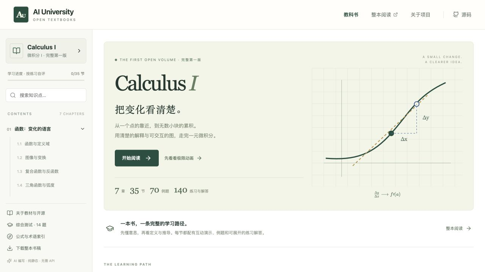

# AI University

**AI 编写的开放教材，一本一本完整完成。** 第一卷是 **Calculus I / 微积分 I**：7 章、35 节、70 道完整例题、140 道节内练习、21 道章末回顾题与 14 道综合题，均附解答。

网站是 React + TypeScript + SVG + KaTeX 的纯静态应用。没有聊天室、模型 API、账户、服务端或付费依赖。AI 用于离线编写与修订教材，读者得到可审查、可下载的固定版本。



## 直接运行

需要 Node.js 22.12+（推荐 24）。

```sh
npm ci
npm run dev
```

打开 `http://127.0.0.1:5173`。不需要 `.env` 或任何 API key。

```sh
npm run check     # 内容、公式、类型、整本生成、构建、数学测试
npm run preview   # 查看构建后的静态版本
```

首次运行开发预览前，可先 `npm run build` 生成整本阅读页与下载书稿。发布只需把 `dist/` 放到任意静态服务器。不要双击 `dist/index.html` 作为 file URL；使用静态 HTTP 服务器。

## 第一卷的完整范围

| 章 | 内容 |
|---|---|
| 1 函数 | 定义域、图像变换、复合与反函数、三角与弧度、指数与对数 |
| 2 极限 | 双侧与单侧、计算法则、ε–δ、连续与介值、无穷与渐近线 |
| 3 导数 | 定义、基本规则、链式、三角、隐式求导 |
| 4 变化模型 | 指数对数、反函数导数、相关变化率、线性近似、牛顿法 |
| 5 导数应用 | 极值、中值定理、凹性、优化、洛必达 |
| 6 积分 | 原函数、黎曼和与数值法、定积分、基本定理、换元 |
| 7 积分应用 | 面积、圆盘圆环、壳层、弧长与曲面、位移功质量 |

每节固定包含：核心意思、直觉、正文、正式定义与条件、推导、互动图、两道例题、常见错误、四道练习及答案、先修关系、难度、误解标签与生成来源。另有术语索引、公式索引、证明补充与综合测试。

数列级数、系统积分技巧、反常积分和多元微积分属于后续卷，第一卷不为它们制造空白章节。下一卷开始前，优先修订这一本。

## 阅读与下载

- 交互网站：目录、阅读、演示、练习、知识连接、章末回顾和综合测试。
- [整本 Markdown 书稿](book/Calculus-I.md)：版本化源产物，包含所有解答。
- `dist/book.html`：无需 JavaScript 的整本阅读页，支持浏览器打印为 PDF。
- `dist/Calculus-I.md`：供网站下载的同版书稿。
- 阅读记录仅保存在浏览器；四道节内练习全部标记理解，才计入节完成度。数值题可以自动检查，其余题为明确标注的自评。没有认证成绩。

## 仓库结构

```text
apps/web/                  静态阅读网站与界面组件
packages/content/          整本目录、35 个 canonical learning objects、回顾与考试
packages/visuals/          可复用数学模型与数值方法
schemas/                   教材 JSON Schema
scripts/                   校验、整本生成、数学回归测试、草稿脚手架
book/                      生成的整本 Markdown 书稿
docs/                      架构、内容规范、生成检查流程、部署与发布
.github/                   CI、静态部署、勘误模板与 PR 模板
```

`packages/content` 是教材事实来源，网站与下载书稿由同一份数据生成。不要直接修改生成的 HTML 或 Markdown；修改章节 JSON 后重新构建。

## 质量与版本

本书为 AI 编写的 **v0.1.0 完整第一版**，不是抽取的示范章节。尚未逐节人工审校。结构校验、公式渲染、先修图与选定数值验证可以发现部分错误，但不等同于逐式形式化证明。欢迎用具体反例、章节位置和可复算步骤提交勘误。

`npm run check` 检查所有章节结构、章节链接、公式语法、先修有向无环图、视觉函数配置与数学模型。浏览器验证记录见 [QA](docs/QA.md)。

## 贡献与开源

阅读 [CONTRIBUTING](CONTRIBUTING.md)、[内容规范](docs/CONTENT_GUIDE.md)、[生成与复核流程](docs/GENERATION_REVIEW.md)、[部署说明](docs/DEPLOYMENT.md) 与 [发布流程](docs/RELEASING.md)。

软件代码使用 [MIT](LICENSE)，原创教材内容与原创图示使用 [CC0 1.0](LICENSE-CONTENT.md)。第三方库保持各自许可，见 [THIRD_PARTY_NOTICES](THIRD_PARTY_NOTICES.md)。不把参考教材的图片或段落复制进本项目。

English: AI University publishes complete AI-authored, versioned textbooks with browser-local interactive mathematics. Calculus I is the first full introductory single-variable calculus volume. No model API or server is required.
