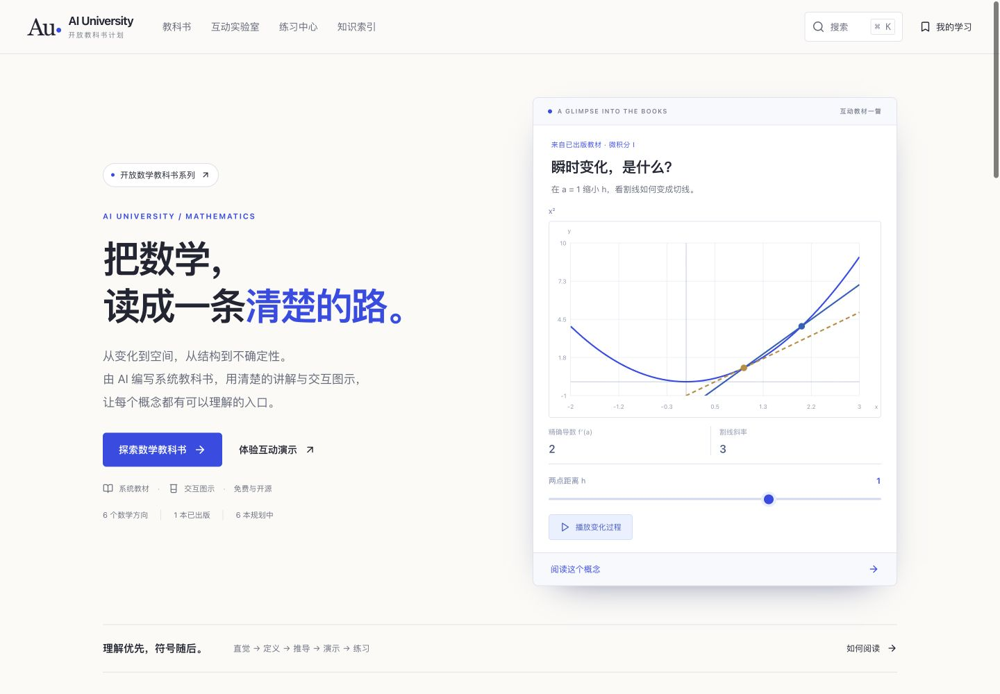

# AI University

外部贡献先隔离、复核，再收录；正式版本由受保护的主分支发布。流程与验证边界见 [贡献保护](docs/CONTRIBUTION_SECURITY.md)。

**AI 编写的开放数学教科书系列，一本一本完整完成。** 首页与书库面向微积分、线性代数、微分方程、概率统计、离散数学、实分析等方向。目前已出版 **Calculus I / 微积分 I**、**Calculus II / 微积分 II**、**Calculus III / 微积分 III**、**Linear Algebra / 线性代数**、**Ordinary Differential Equations / 常微分方程**，分别为 35、35、40、50、55 节完整正文，均包含条件、推导、可操作图示、例题与完整练习解答。

| 教材 | 章 | 节 | 例题 | 节内练习 | 回顾 / 综合题 |
|---|---:|---:|---:|---:|---:|
| Calculus I · v0.3.2 | 7 | 35 | 79 | 153 | 24 / 14 |
| Calculus II · v0.1.1 | 8 | 35 | 72 | 141 | 24 / 14 |
| Calculus III · v0.1.1 | 9 | 40 | 81 | 160 | 27 / 16 |
| Linear Algebra · v0.1.0 | 10 | 50 | 100 | 200 | 30 / 20 |
| Ordinary Differential Equations · v0.1.0 | 11 | 55 | 110 | 220 | 33 / 22 |

网站是 React + TypeScript + SVG + KaTeX 的纯静态应用。没有聊天室、模型 API、账户、服务端或付费依赖。AI 用于离线编写与修订教材，读者得到可审查、可下载的固定版本。

[在线阅读](https://b1n9ui.github.io/ai-university/) · [微积分 I](https://b1n9ui.github.io/ai-university/#/book/calculus-1) · [微积分 II](https://b1n9ui.github.io/ai-university/#/book/calculus-2) · [微积分 III](https://b1n9ui.github.io/ai-university/#/book/calculus-3) · [线性代数](https://b1n9ui.github.io/ai-university/#/book/linear-algebra) · [常微分方程](https://b1n9ui.github.io/ai-university/#/book/ordinary-differential-equations) · [开源发布](https://github.com/b1n9ui/ai-university/releases)



当前出版与核验记录：[常微分方程首版](docs/ODE_AUDIT.md) · [线性代数首版](docs/LINEAR_ALGEBRA_AUDIT.md) · [微积分三卷修订](docs/CALCULUS_SERIES_REVIEW.md)。

## 直接运行

需要 Node.js 22.12+（推荐 24）。

```sh
npm ci
npm run dev
```

打开 `http://127.0.0.1:5173`。不需要 `.env` 或任何 API key。

```sh
npm run check     # 内容、公式、类型、整本生成、构建、数学测试
npm run preview   # 查看构建后的静态版本
```

首次运行开发预览前，可先 `npm run build` 生成整本阅读页与下载书稿。发布只需把 `dist/` 放到任意静态服务器。不要双击 `dist/index.html` 作为 file URL；使用静态 HTTP 服务器。

## 数学系列与书库

`packages/content/library.json` 统一维护数学方向、教材简介和出版状态。当前 3 本已出版、5 本规划中；规划条目不提供空白章节或阅读链接。新增规划会自动进入首页方向与书库，整本内容接入完成后再出版。详见 [系列目录与新增教材](docs/LIBRARY.md)。

## 第一卷的完整范围

| 章 | 内容 |
|---|---|
| 1 函数 | 定义域、图像变换、复合与反函数、三角与弧度、指数与对数 |
| 2 极限 | 双侧与单侧、计算法则、ε–δ、连续与介值、无穷与渐近线 |
| 3 导数 | 定义、基本规则、链式、三角、隐式求导 |
| 4 变化模型 | 指数对数、反函数导数、相关变化率、线性近似、牛顿法 |
| 5 导数应用 | 极值、中值定理、凹性、优化、洛必达 |
| 6 积分 | 原函数、黎曼和与数值法、定积分、基本定理、换元 |
| 7 积分应用 | 面积、圆盘圆环、壳层、弧长与曲面、位移功质量 |

每节固定包含：核心意思、直觉、正文、正式定义与条件、推导、互动图、两道例题、常见错误、四道练习及答案、先修关系、难度、误解标签与生成来源。另有术语索引、公式索引、证明补充与综合测试。

## 第二卷的完整范围

| 章 | 内容 |
|---|---|
| 1 积分技巧 | 分部、三角积分、三角代换、部分分式、方法选择 |
| 2 延伸与建模 | 数值积分误差、无穷尾部、有限奇点、旋转侧面积、质心、压力与功 |
| 3 数列与无穷和 | 数列极限、递推与单调有界、部分和、几何与望远镜级数 |
| 4 收敛判别 | 积分与尾界、比较、比值与根值、交错与误差 |
| 5 幂级数 | 绝对与条件收敛、半径和端点、逐项运算、Taylor 多项式 |
| 6 展开与计算 | Taylor 余项、基本展开、积分与极限、广义二项式 |
| 7 曲线与坐标 | 参数运动、切线与弧长、极坐标、极坐标面积与弧长 |
| 8 一阶方程 | 方向场、分离变量、积分因子、Euler 与 Logistic |

## 第三卷的完整范围

| 章 | 内容 |
|---|---|
| 1 向量与空间 | 向量、点积、叉积、直线平面、二次曲面、柱坐标与球坐标 |
| 2 空间曲线 | 向量值函数、运动与路程、弧长参数与曲率 |
| 3 多元微分 | 函数与等高线、多元极限、偏导、可微与切平面、链式与隐函数、梯度 |
| 4 近似与优化 | 二阶 Taylor、临界点、闭区域全局最值、Lagrange 乘子 |
| 5 二重积分 | Fubini、一般区域与换序、极坐标、质量质心与惯量 |
| 6 三重积分 | 空间区域、柱坐标、球坐标、一般换元与 Jacobian |
| 7 曲线积分 | 向量场、标量弧长积分、功、势与定义域、Green 与平面通量 |
| 8 曲面积分 | 参数曲面与定向、面积、通量、散度与旋度 |
| 9 积分定理 | Stokes、散度定理、方法选择、连续性与守恒 |

40 个本地三维图示可拖动旋转、缩放，以方向键操作，并切换俯视/正视。它们用等比例空间坐标和 SVG 投影，不要求 WebGL；解析读数、有限近似和显示倍率分别说明。每节有三步可载入实验，合计 120 个预设。检查范围见 [Calculus III 审查记录](docs/CALCULUS_III_AUDIT.md)。

三卷分别版本化，课程划分不等同于所有学校；线性代数与常微分方程已作为独立整卷出版；深入扭率理论、微分形式与偏微分方程留给后续教材。

## 数学展览馆界面

首页采用整屏数学场景，展示可操作的波面、环面和螺旋。参数改变真实几何，形态切换使用同一网格的连续插值。表面材质、灯光与少量辉光用于显示空间层次，颜色不表示额外数学结论。展示模型与正式教材章节分开管理，不把它们当作新增或已出版的章节。

首屏动效可暂停，离开可见区域或切到其他标签页时停止；减少动画偏好关闭默认旋转和形态过渡。按需加载 Three.js，首页的互动实验区接近可见时才挂载。阅读页提供专注模式，书库区分已出版与规划教材。参考实例、实际截图与检查见 [本轮设计记录](docs/IMMERSIVE.md)。

## 阅读与下载

- 网站 v0.13.0：数学系列首页、按方向和出版状态筛选的书库、教材主页、45 个章节主页、215 个知识点页面、实验室、分页练习中心、全文搜索、公式/术语/附录索引、阅读指南、下载、项目与贡献资料。
- 阅读页：专注模式、嵌入演示、页内定位、上下节翻页、收藏、较大字号与已读标记。练习支持逐题/连续查看、提示、完整解答与数值检查。
- [微积分 I 书稿](book/Calculus-I.md)与[微积分 II 书稿](book/Calculus-II.md)、[微积分 III 书稿](book/Calculus-III.md)与[线性代数书稿](book/Linear-Algebra.md)、[常微分方程书稿](book/Ordinary-Differential-Equations.md)：版本化源产物，包含所有解答。
- `dist/book.html` 与 `dist/calculus-2.html` 与 `dist/calculus-3.html` 与 `dist/linear-algebra.html`：五卷各自的完整阅读页（另含 `dist/ordinary-differential-equations.html`），公式预先排版，支持浏览器打印为 PDF。
- `dist/Calculus-I.md` 与 `dist/Calculus-II.md` 与 `dist/Calculus-III.md` 与 `dist/Linear-Algebra.md`：供网站下载的同版书稿。
- 阅读、收藏和练习记录仅保存在浏览器，可导出与导入。已读标记与练习掌握状态分别记录；数值题可以检查数值，其余题为明确标注的自评。没有认证成绩。

## 仓库结构

```text
apps/web/                  静态阅读网站与界面组件
packages/content/          五卷目录、215 个 canonical learning objects、回顾与考试
packages/visuals/          可复用数学模型与数值方法
schemas/                   教材 JSON Schema
scripts/                   校验、整本生成、数学回归测试、草稿脚手架
book/                      生成的整本 Markdown 书稿
docs/                      架构、内容规范、生成检查流程、部署与发布
.github/                   CI、静态部署、勘误模板与 PR 模板
```

`packages/content` 是教材事实来源，网站与下载书稿由同一份数据生成。不要直接修改生成的 HTML 或 Markdown；修改章节 JSON 后重新构建。

## 质量与版本

网站版本 **v0.13.0**；微积分 I 内容为 **v0.3.2**，微积分 II、III 为 **v0.1.1**，线性代数和常微分方程均为 **v0.1.0**。尚未逐节人工审校。结构校验、公式渲染、先修图与选定数值验证可以发现部分错误，但不等同于逐式形式化证明。欢迎用具体反例、章节位置和可复算步骤提交勘误。

`npm run check` 检查所有章节结构、章节链接、公式语法、先修有向无环图、视觉函数配置与数学模型。浏览器验证记录见 [QA](docs/QA.md)。

## 贡献与开源

阅读 [CONTRIBUTING](CONTRIBUTING.md)、[内容规范](docs/CONTENT_GUIDE.md)、[生成与复核流程](docs/GENERATION_REVIEW.md)、[部署说明](docs/DEPLOYMENT.md) 与 [发布流程](docs/RELEASING.md)。

软件代码使用 [MIT](LICENSE)，原创教材内容与原创图示使用 [CC0 1.0](LICENSE-CONTENT.md)。第三方库保持各自许可，见 [THIRD_PARTY_NOTICES](THIRD_PARTY_NOTICES.md)。不把参考教材的图片或段落复制进本项目。

English: AI University publishes complete AI-authored, versioned textbooks with browser-local interactive mathematics. Calculus I is the first full introductory single-variable calculus volume. No model API or server is required.

## 教学与视觉修订

第一卷 35 节核心说明、直觉和正文已压缩重写；新增 35 个概念检查与 35 个演示预测问题。例题先显示题目，解法可以按需展开。极限/导数提供孔洞、跳跃、尖角对比。空间几何使用 Three.js 本地渲染，包含圆盘、圆环、圆柱壳与旋转曲面，可拖动、缩放、改变转角并切换二维图；无需 API、在线模型或外部图形服务。

- [教学研究与来源](docs/LEARNING_RESEARCH.md)
- [本轮设计与验证](docs/FRONTIER.md)
- [网站上的学习方法与参考资料](https://b1n9ui.github.io/ai-university/#/about/research)

第一卷旋转体与首页 3D 使用 WebGL 2，无法显示时可切回二维演示；第三卷本地空间图使用 SVG 投影，不依赖 WebGL。数学与结构检查并不证明所有解答无误，也不代替读者学习效果测试。

本轮 Calculus I 的课程覆盖、具体补全与复算证据见 [内容复核](docs/CALCULUS_I_AUDIT.md)。

三卷支持固定的回答式教学：110 种另一角度的解释、330 个可载入的三步实验、可输入数值的参数控件、分层提示与针对性反馈。内容由 AI 离线编写，浏览器只呈现固定教材与本地数学计算，不调用实时模型。

本轮界面精修、实际前后截图与检查记录见 [VISUAL_REFINEMENT.md](docs/VISUAL_REFINEMENT.md)。
