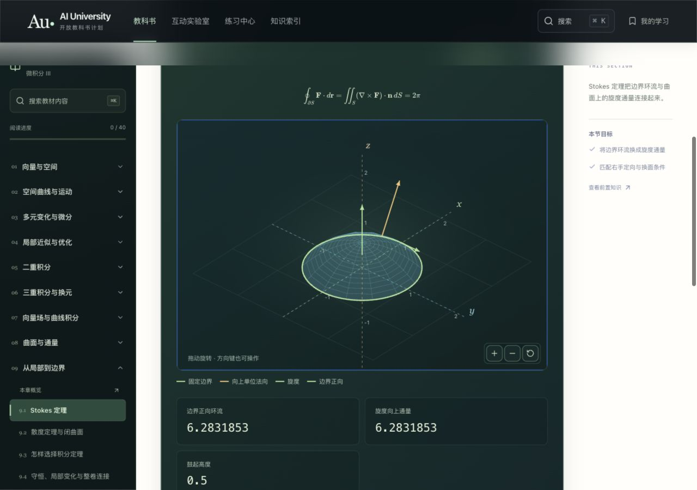

# Calculus III · v0.1.0 整卷复核

日期：2026-10-14（America/Los_Angeles）。网站 v0.10.0。AI 独立编写，humanReviewed=false。前两卷 canonical 内容保持原版本；本轮新增第三卷，并修正共用滑块的非小数端点吸附。

## 完整范围

9 章 40 节、80 个逐步例题、160 道节内练习、27 道独立章末题、16 道独立综合题，共 203 道有提示与完整解答的题目。另有 46 条术语和 6 篇补充。每节包含定义与条件、推导、概念检查、另一种简短解释、三步实验和可操作图。

| 章 | 覆盖 | 重点边界 |
|---|---|---|
| 向量与空间 | 坐标、点积投影、叉积体积、直线平面、二次曲面、柱/球坐标 | 零向量、方向顺序、异面直线、坐标退化 |
| 空间曲线 | 分量微积分、运动、路程、曲率 | 零速度、重复路径、曲率与速率分开 |
| 多元微分 | 函数、极限、偏导、可微、切平面、链式隐函数、梯度 | 路径反例与统一估计、混合偏导条件、局部隐函数正则性 |
| 局部与全局优化 | 二阶 Taylor、临界点、闭区域、Lagrange | 混合项、退化判别、边界、奇异约束、候选不等于最优 |
| 二重积分 | Fubini、一般域换序、极坐标、质心惯量 | 可积条件、分块、实际面积倍率、质量单位 |
| 三重积分 | 空间域、柱/球坐标、一般换元 | 倾角约定、Jacobian 绝对值、全局重复覆盖 |
| 曲线积分 | 场、弧长标量积分、功、势、Green | 有向/无向、全局势、洞与奇点、内边界方向 |
| 曲面积分 | 参数曲面、面积、通量、散度旋度 | 规则性、可定向性、叉积倍率不重复、局部与净量 |
| 积分定理 | Stokes、Gauss、方法选择、守恒 | 开面/闭面、兼容法向、光滑邻域、补面、密度乘速度 |

本卷是一套完整的多元与向量微积分课程范围，不等同于各校的第三学期安排。扭率的系统理论、微分形式、完整线性代数、二阶微分方程与 PDE 求解不在本卷范围内，未放空白章节。

## 原创编写与参考范围

[MIT 18.02SC 课程范围](https://ocw.mit.edu/courses/18-02sc-multivariable-calculus-fall-2010/pages/syllabus/)用于知识范围与顺序核对；[OpenStax Volume 3](https://openstax.org/books/calculus-volume-3/pages/preface)用于定义和定理前提核对，特别是[一般换元](https://openstax.org/books/calculus-volume-3/pages/5-7-change-of-variables-in-multiple-integrals)、[Stokes](https://openstax.org/books/calculus-volume-3/pages/6-7-stokes-theorem)和[散度定理](https://openstax.org/books/calculus-volume-3/pages/6-8-the-divergence-theorem)。正文、例题、练习、完整解答和空间图均重新编写，不复制讲义、题库、图片或受限表达。参考文献不表示这些机构审定了本书。

## 数学与模型检查

- 空间投影在三维中使用正交基，三轴单位尺度一致；旋转后的三维点积与原点积一致。二维屏幕投影本身会压缩深度，不宣称二维投影保持所有长度。
- 叉积与面积、法向正交关系核对；螺旋曲率与独立有限差分得到的速度、加速度比较。
- 可微余项按距离归一化；多元极限使用路径冲突反例与统一夹逼，图上采样不作为存在性证明。
- Taylor 实际误差与独立三阶余项界比较；偏导、梯度、沿路径链式贡献检查。
- 中点和与解析积分比较；有限扇形面积与独立径向积分比较；质心、四面体截面和抛物面盖体积重新积分。
- 圆环流与独立参数积分、球通量与独立曲面积分及散度体积分比较；坡面通量检查法向分量与真实面积倍率的相消。
- 连续性模型同时检查局部时间导数与散度相消，以及固定球内质量导数与边界外流率相消。
- 全部 120 个教学预设、每个控件两端及组合边界生成有限几何。动画六秒到明确合法终点并停留；趋零参数最小为正数，不除以零。
- 共用参数控件不再把 π、2π 吸附到十进制格点。Home/End 到精确端值，方向键按声明步长移动，整数分段仍约束整数。

## 实际页面检查

应用内浏览器完成全卷 40 节的阅读、演示、练习：1280 像素桌面 120 个状态、390 像素手机 120 个状态。桌面逐个滑块按 Home/End；全卷页面未发现 KaTeX 错误、非有限 SVG 数值或整页横向溢出。

逐次点击全部 120 个引导实验，核对实际控件值与 canonical 预设，包括精确角度；三维、俯视、正视、键盘旋转与 Home 恢复均检查。另检查第三卷目录、九章主页、实验室、练习/综合、公式/术语/附录、下载、指南和本地学习页，共 21 个手机页面。整本预排版 HTML 实际包含 40 节、80 例题、203 题，未见公式错误。

三维使用本地空间坐标与 SVG 深度排序，不需要 WebGL、模型 API 或外部图形服务。手机图内拖动旋转，正文区域正常滚动；视图有文字说明与可读数值，不把颜色作为唯一信息。

新增可复用 Playwright 用例；本轮 UI 验证实际使用应用内浏览器，不把独立 Playwright 套件计为已执行。

实际检查还确认手机拖动改变三维投影、俯视与正视可切换、动画到 0.0001 停止；π 端点与 pi/2 输入同步到读数。第三卷已读标记刷新后保留，第二卷计数不受影响，临时标记已撤销。第三卷下载链接指向自己的 Markdown 和打印文件，搜索显示所属教材。

## 验证边界

本轮生产构建与 60 项 Node 回归检查通过，覆盖全站三卷目录、公式、唯一 ID、跨卷先修 DAG、三卷书稿和所述数学模型。它们不能替代逐式形式化证明、人工逐节审校或学习效果实验。一般 Green/Stokes/Gauss 推广和隐函数等定理明确标注引用范围，局部推导或有限网格不冒充完整一般证明。发现问题继续按固定版本勘误修订。
