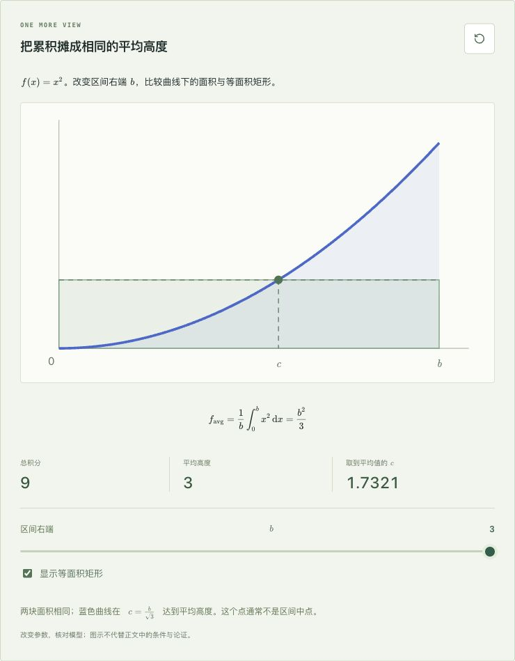
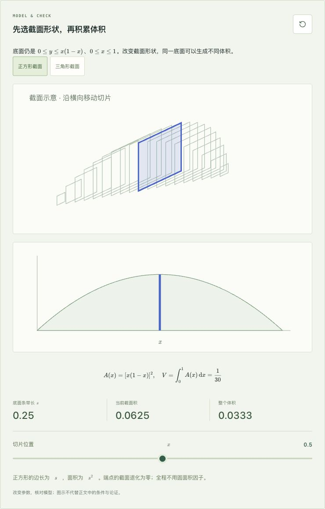
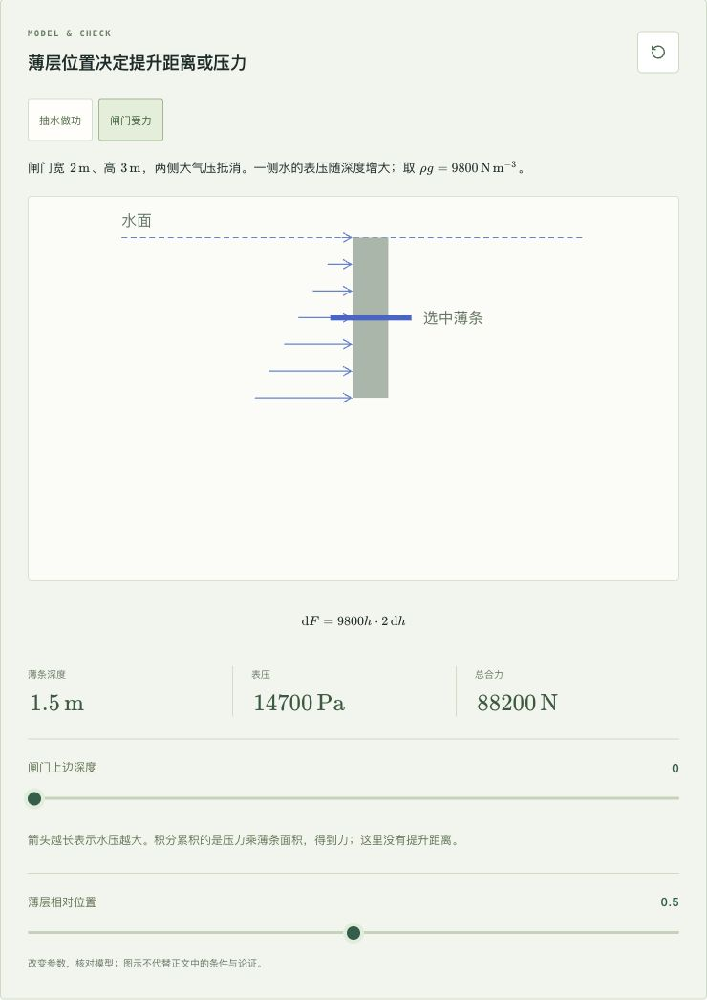

# Calculus I 内容复核 · v0.3.0

日期：2026-10-12。网站版本：v0.6.0。

结论：上一版覆盖了微积分 I 的主线，但几处知识点只有一句提及，尚不足以支持独立学习。本轮先补齐这些内容，Calculus II 继续保持规划状态，不以空目录冒充已完成教材。

## 课程覆盖

| 主线 | 本书位置 | 本轮发现与处理 |
|---|---|---|
| 函数、复合、反函数、弧度、指数对数 | 第 1 章 | 保留；反函数导数的例题另补局部可逆条件 |
| 单双侧极限、夹逼、严格定义、连续、介值、渐近线 | 第 2 章 | 保留定义与基本三角极限证明补充 |
| 导数定义、计算法则、链式、三角、隐式 | 第 3 章 | 隐式二阶导数原来只说“再求导”；现在有完整计算及练习 |
| 指数对数、反三角、相关变化率、线性化、牛顿法 | 第 4 章 | 增加圆锥注水的相似关系建模；修复百分号显示及反函数条件 |
| 极值、中值、凹性、优化、洛必达 | 第 5 章 | 增加“导数比无极限，原比值仍有极限”的反例与乘积型换算题 |
| 原函数、黎曼和、定积分、基本定理、换元 | 第 6 章 | 补常见原函数、积分中值定理与连续条件、非单调换元的方向核对 |
| 面积、体积、弧长、旋转侧面积、运动、功、质量 | 第 7 章 | 从圆盘/圆环扩展到一般截面；补抽水做功与静水压力的完整薄层模型 |

平均值公式上一版已经存在；本轮补的是“为何有某点取到它”及不连续时的反例，不将既有内容误记为缺失。

范围核对参考 [OpenStax 积分中值定理](https://openstax.org/books/calculus-volume-1/pages/5-3-the-fundamental-theorem-of-calculus)、[一般截面与旋转体](https://openstax.org/books/calculus-volume-1/pages/6-2-determining-volumes-by-slicing)、[物理应用](https://openstax.org/books/calculus-volume-1/pages/6-5-physical-applications)。这里只用作主题与条件核对；新增文字、题目、图示独立编写，未复制教材段落或图像。[MIT 单变量微积分课程](https://ocw.mit.edu/courses/18-01sc-single-variable-calculus-fall-2010/pages/syllabus/)覆盖更宽，不把它整个课程等同于本卷边界。

系统积分技巧、反常积分、数列级数、泰勒逼近、参数曲线与极坐标仍属于后续 Calculus II；多元微积分留给 Calculus III。数值积分在本卷有入门，系统误差界与更多方法在后续卷展开。

## 学习材料

- 保留 7 章、35 节与已有题目 ID，方便原有阅读记录继续使用。
- 79 个逐步例题，153 道节内练习，24 道章末回顾，14 道综合题；共 191 道练习，均有解答。
- 对 140 道原节内练习逐题检查难度和误区标签；移除不相关标签，不把“能渲染”当成标签正确。空标签表示题目不直接针对本节列出的误区。
- 35 道原回顾/综合题的统一空泛提示改为各题具体入口，新增回顾题也有独立提示。
- 网站、书稿封面和下载页从 canonical 内容计算数量；更新可复用浏览器测试的计数预期。

## 新图示

平均高度图比较曲线与等面积矩形；截面图可切换正方形与底高相同的三角形，并移动切片；水模型可切换抽水与闸门受力，调整水位、出口、深度和选中薄层。全部在浏览器本地计算，保留原来的三维旋转体演示。

## 复算与验证

- `npm run check`：教材结构、数学排版、类型、整本生成和生产构建通过；33 项测试通过。
- 一般体积通过独立多边形面积及数值积分核对；抽水功通过总重量乘重心提升距离核对；水压力通过平均压力乘平板面积核对。
- 隐式二阶导数与显式圆分支的差分结果一致；新原函数求导恢复被积式；非单调换元的两段抵消；洛必达反例的两条导数比子序列不一致而原比值一致。
- [155 次页面检查与 22 次边界状态检查](images/calc-one-audit/checks.json)：实际 1440/390 像素宽度，无 KaTeX 错误、数学标记泄漏、无效 SVG 数值或整页横向溢出。全部 35 节阅读与练习页的数量和源内容一致。
- 整本 HTML 实际含 35 节、79 例题、191 练习、2,340 个公式节点，零公式错误。手动展开相对误差题，确认百分号完整显示。
- 可复用 Playwright 浏览器套件已随数量更新；本轮浏览器检查通过应用内浏览器执行，未把独立 Playwright 套件计为已运行。

检查范围包括全书定义、条件、例题与练习答案阅读复核，重点独立复算新增内容和已有可视化模型。程序与阅读复核均不能证明整本教材绝无错误，也未声称有人类逐节审阅。后续继续按公开勘误流程改进。
