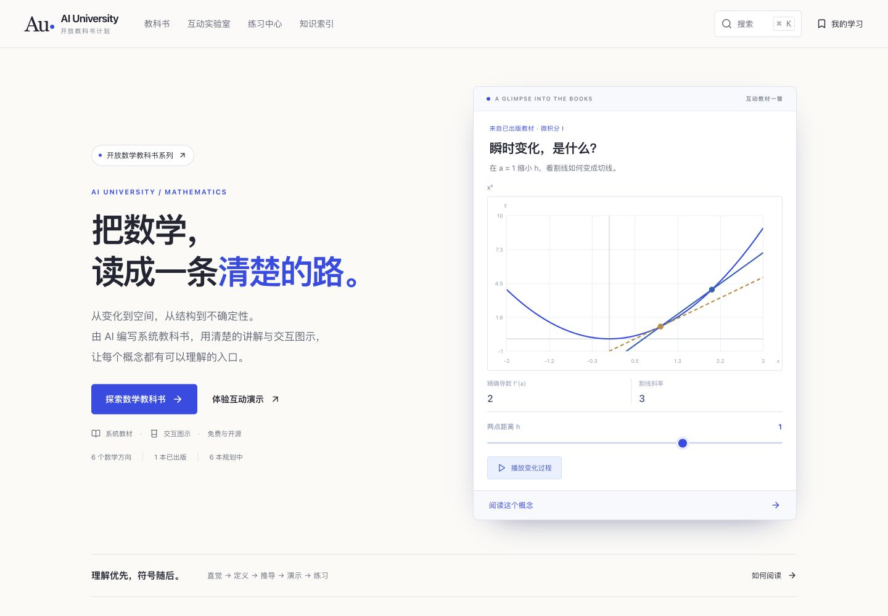
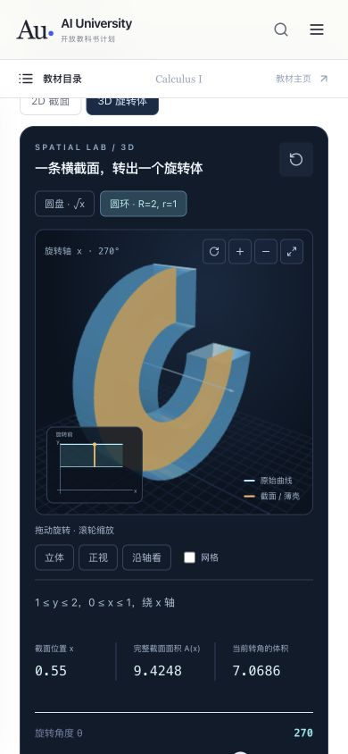

# v0.3.0 教材与交互改进

日期：2026-10-10。网站 v0.3.0，Calculus I 固定书稿 v0.2.0。正文仍由 AI 编写；本记录描述实现与检查，不代表学习效果实验或逐节人工审校。

研究来源、选择理由与证据边界见 [学习设计研究](LEARNING_RESEARCH.md)。本轮采用具体问题进入概念、图像与公式对照、先尝试后看解答、主动回忆与反馈等方法。保留完整 7 章 35 节，不以缩短篇幅代替定义条件和推导。

## 1. 数学系列首页

**路径：** 首页 → 教科书库 / 三种首页演示。

**原状：** 系列入口已经存在，但视觉层次较平，首页演示仅呈现二维变化。

**改进：** 首页以“数学，讲清楚。”进入数学系列；保留 1 本已出版、6 本规划中的区分。深色图示区与浅色阅读区分工明确。首页提供空间与体积、瞬时变化、细分与累积三种可操作演示，入口指向实际存在的章节。

**状态：可用。** 已检查 390、768、1440 宽度，未发现整页横向溢出。规划书没有虚构的正文链接。缩小屏幕会重排版面，动效遵守减少动画偏好。

| 改进前 | 改进后 |
| --- | --- |
|  |  |

## 2. 从解释到独立尝试

**路径：** 任一知识点 → 正文 → 概念检查 → 例题 → 练习。

**原状：** 讲解存在重复和泛泛提示，例题步骤直接展示，读者容易把熟悉答案当成掌握。

**改进：** 35 节的 concept、intuition、body 三组文字重写为直接解释和三个具体问题。这三组字段从 11,090 字符减为 8,374 字符，减少约 24.5%；此数字不指整本书长度。每节增加一个针对误区的概念检查，共 35 个，选择后解释条件和错误原因。70 道例题默认收起解题步骤，读者可以先独立尝试。定义、推导、例题、误区与 175 道练习仍在完整书稿中。

**状态：可用。** 浏览器逐节检查 35 个正文与 35 个演示视图；手机复查全部 70 个视图。实际操作确认错误反馈、正确反馈、例题展开可用。整本 HTML 检查得到 35 节、70 例题、175 练习、35 概念检查，未发现 KaTeX 错误。缩短文字与增加检查是否改善学习，需要后续读者实验。

| 改进前 | 改进后 |
| --- | --- |
|  |  |

## 3. 二维、三维与反例

**路径：** 极限 / 导数 → 交互演示；圆盘圆环 / 圆柱壳 / 弧长曲面 → 2D 与 3D。

**原状：** 旋转体主要依靠二维示意；不能直接看出旋转形成的孔洞与空间关系。

**改进：** 用 Three.js 渲染真实旋转几何，并保留原始二维轮廓。圆盘、带孔圆环、圆柱壳、旋转曲面都有对应颜色的边界和截面，旋转角度、截面位置、数值与公式同步。曲面只画侧面，不添加端盖。支持拖动旋转、缩放、预设视角、网格、键盘箭头与加减号。动画由读者启动，可暂停、改速度；不可见时暂停。几何按需渲染，离开页面释放资源。

极限增加孔洞与跳跃的对比，导数增加光滑曲线与绝对值尖点的对比。每节演示前都有“先预测，再动手”的具体问题。修复了切换反例后仍显示原例说明的问题，反例字幕与无障碍描述现在同步更新。

**状态：可用，有明确兼容性边界。** 实际浏览器检查三维渲染、圆环孔洞、角度端点、播放与暂停、视角按钮、拖动、键盘操作、网格、二维切换和数值。独立数学测试检查区域约束、体积与侧面面积。WebGL 不可用或上下文丢失时提供二维入口，但本轮没有在不支持 WebGL 的真实设备上验证该路径。

| 改进前 | 改进后 |
| --- | --- |
|  |  |

## 检查记录与限制

- `npm run check` 通过：35 个 learning objects、474 处公式、TypeScript、整本书生成、生产构建、16 项内容与独立数学检查。
- [逐节检查](images/frontier/lesson-qa.json)：35 节的正文与演示、滑块两端、公式错误与 SVG 非有限数值。
- [手机检查](images/frontier/mobile-qa.json)：390×844 下全部 70 个正文与演示视图。
- [响应式检查](images/frontier/responsive-qa.json)：9 个代表页面 × 3 种宽度，共 27 个视图。
- 本轮截图来自实际浏览器；生产预览中检查下载书稿和参考资料页。独立 Playwright 套件已更新，但未将未运行的套件计为通过。
- 新的 3D 模块按需加载，约 563 kB 原始体积、143 kB gzip。构建有模块体积提示；阅读正文不需要加载该模块。
- 无障碍检查覆盖语义控件、键盘、焦点入口和减少动画偏好；没有屏幕阅读器实机检查或完整 WCAG 审计。图示内较小标签仍需结合使用反馈改进。
- 数值、几何采样与动画帮助理解，不替代证明。没有逐道形式化证明全部题目，也没有证明本书优于其他教材。

