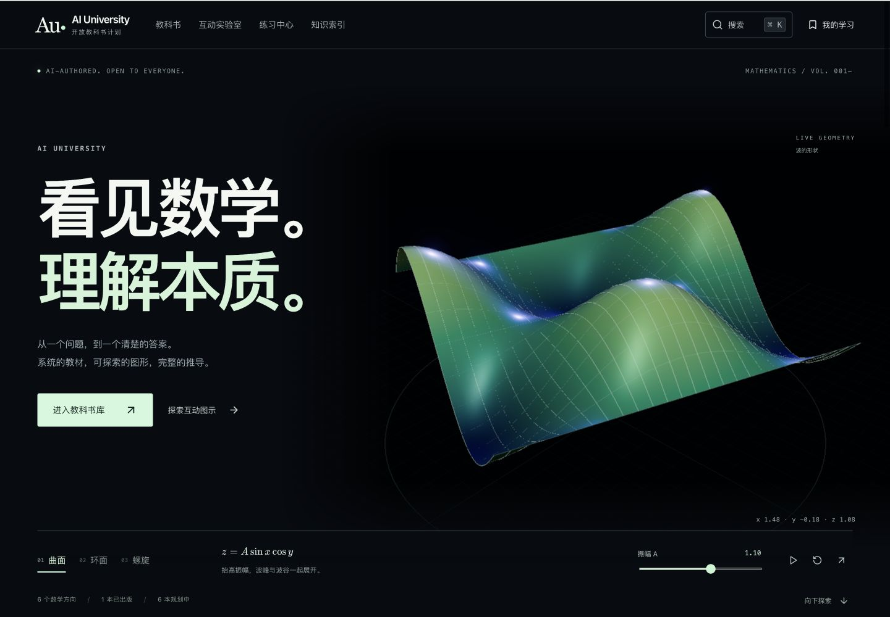
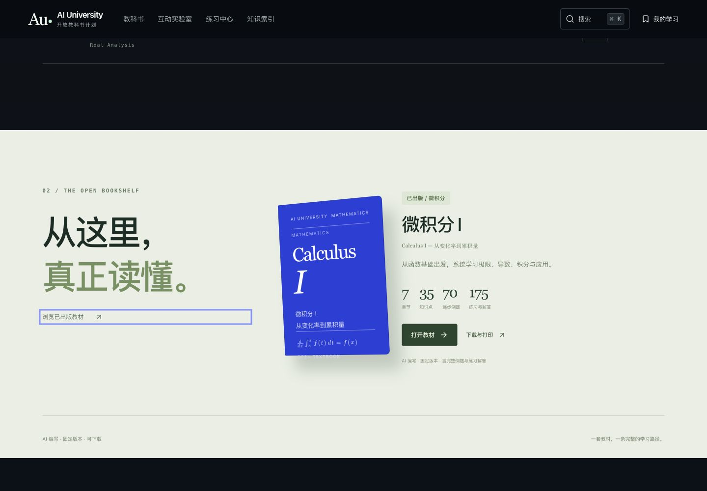
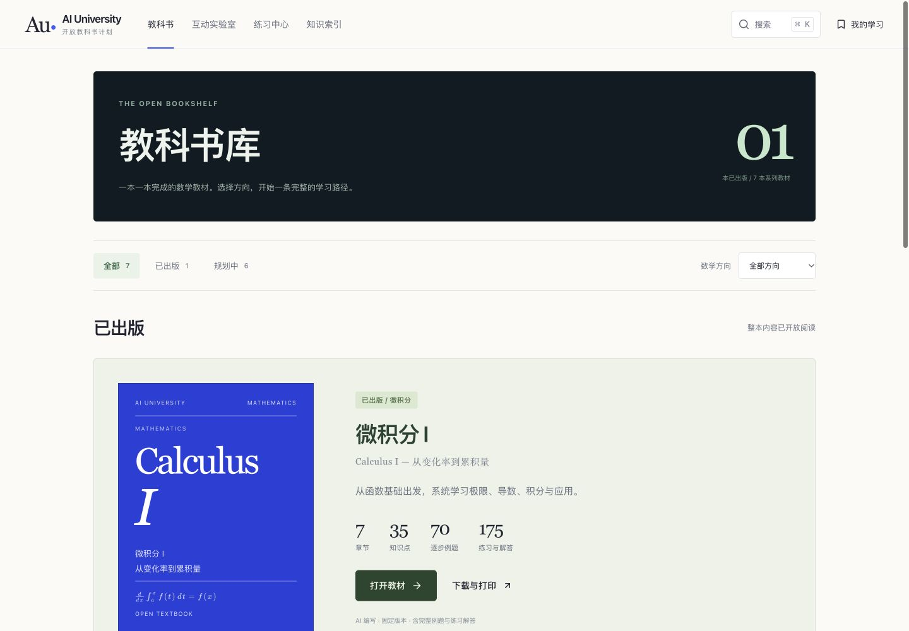
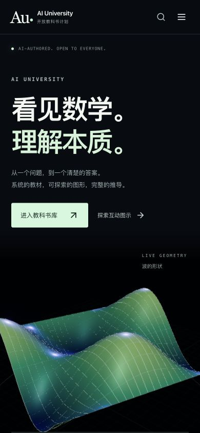
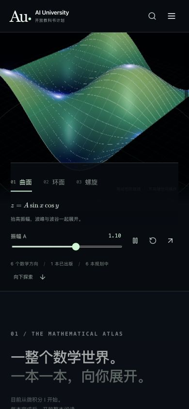

# v0.4.0：数学展览馆

日期：2026-10-10。网站 v0.4.0，Calculus I 固定教材仍为 v0.2.0。

这次重做首页构图、书库和阅读入口。网站保持纯静态；动画与图形在浏览器运行，无模型 API、聊天室、账户或后台。

## 参考与判断

- [作者自述的 Opus 5.5 动效实验](https://www.reddit.com/r/ClaudeCode/comments/1wv07q9/i_tested_claude_opus_55s_motion_design/)与其[实际作品](https://shivamk.dev/)：实际打开首页并滚动观察。大字、贯穿页面的线条与进入动效形成整体构图。模型归属来自作者自述，没有独立验证。
- [GPT 5.5 Pro 的作者展示](https://www.reddit.com/r/codex/comments/1svoe0h/ever_wondered_how_good_gpt_55_pro_is_at_ui/)：读取了作者描述，但浏览器访问受到 CAPTCHA 阻挡，未完成实际作品核验。因此没有据此进行模型能力排名。
- [Linear](https://linear.app/)：实际观察首页的大尺度文字与产品画面层级。它是产品设计参考，不作为 AI 制作案例。
- [Bruno Simon](https://bruno-simon.com/)：实际观察加载后的三维起始场景；没有完成游戏式漫游。参考空间构图，不借用素材，也不声称其由 AI 制作。
- 实现依据 [Three.js 的材质文档](https://threejs.org/docs/pages/MeshPhysicalMaterial.html)和[泛光文档](https://threejs.org/docs/pages/UnrealBloomPass.html)，使用已有开源依赖。

参考截图保留在 `images/immersive/ref-*`。以上是有依据的设计参考，不是“全网最好网站”的穷尽调查。

## 1. 从首页进入数学方向 — 已完成

旧版：文字、一个小演示框、连续卡片。新版：全幅数学舞台、大尺度标题、统一参数控制台；继续向下进入六个数学方向、完整教材书架和学习演示。已出版与规划中仍明确区分。

首页的三种形态由真实参数方程计算：

- 曲面 `z = A sin(x) cos(y)`，`A ∈ [0.1, 1.8]`。
- 环面大半径为 2，小半径 `r ∈ [0.25, 1.2]`；始终保留孔洞。
- 螺旋中心线 `(1.65 cos t, 1.65 sin t, p(t−3π))`，`t ∈ [0,6π]`，`p ∈ [0.1,0.3]`。为便于观看，展示半径 0.12 的管面，并明确标注中心线含义。

支持形态间顶点过渡、参数变化、拖动视角、方向键、暂停与恢复。鼠标指向图面可读取实际表面坐标。自动旋转离开视口或隐藏页面后暂停；降低动态效果偏好会关闭自动旋转与进入动画。图像用于探索，不能替代数学证明。

## 2. 从书库打开完整教材 — 已完成

书库使用清晰的出版数量、方向筛选和完整教材展陈。首页以实体书的空间构图展示 Calculus I，保留 7 章、35 节、70 例题、175 练习、下载及打印入口。其余教材继续显示真实的规划状态。

## 3. 从知识点进入阅读与演示 — 已完成

阅读页采用章节编号、大标题、明确结论与安静的正文排版。新增专注阅读，收起两侧目录；手机上仍可打开教材目录并切换章节。退出或切换知识点会恢复正常阅读布局。

## 验证与边界

- `npm run check` 通过：结构验证、474 处 canonical 公式严格渲染、TypeScript、整本书稿生成、生产构建与 20 项内容/数学测试。
- 新增 4 项独立数学核对：曲面高度与导数、环面隐式方程与孔洞、螺旋管面半径和节距、非法参数拒绝。
- 实际浏览器打开全部 35 节正文，在 390 和 1440 两种宽度共 70 个视图检查标题、公式错误与整页横向溢出，未发现失败。
- 首页、书库、教材主页、实验室、练习、索引、下载、学习记录、版本页共 9 个入口，在 390 / 768 / 1440 三种宽度共 27 个视图检查，未发现上述布局错误。
- 实际操作三种首页形态，逐一检查六个参数端点与形状同步；检查拖动、方向键、暂停、恢复、首页三种学习演示切换、桌面专注模式、手机目录及切换章节。
- 首页离开视口后实际渲染计数停在 67，后续读取仍为 67。浏览器未记录错误。本次没有完整性能基准，不声称所有设备都能达到固定帧率。
- 本轮改动没有重写教材正文，也没有再次操作每一节的全部旧控件。以前的数学/交互验证见 [v0.3.0 记录](FRONTIER.md)。
- 3D 首屏需要 WebGL2，提供不可用提示；低性能真实手机、失去 WebGL 上下文、系统降低动效偏好与屏幕阅读器尚未全部实机验证。Three.js 模块按需加载，生产构建仍提示较大的 3D 分包。
- 教材由 AI 编写；未进行逐节人工审校或读者学习效果实验。

## 运行与发布

`npm install` 后运行 `npm run dev`；`npm run check` 生成 `dist/`，可直接部署至静态托管。GitHub Pages 工作流重新构建并发布同一提交；发布附件包含源码、静态网站和完整书稿。代码 MIT，教材 CC0。
