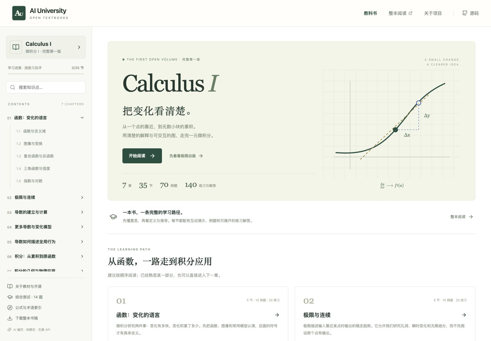
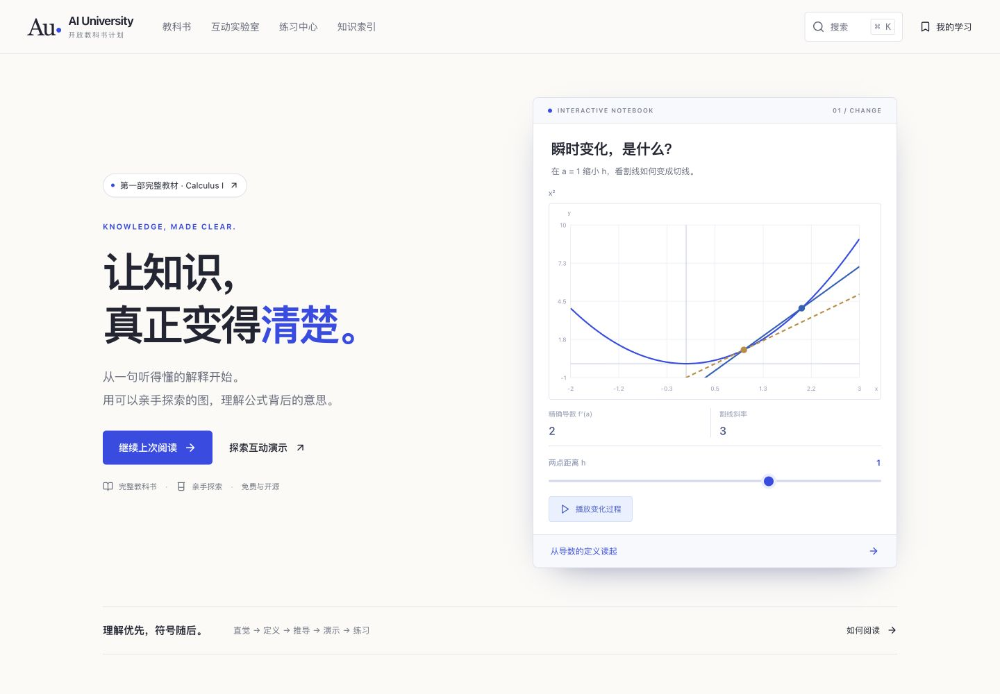
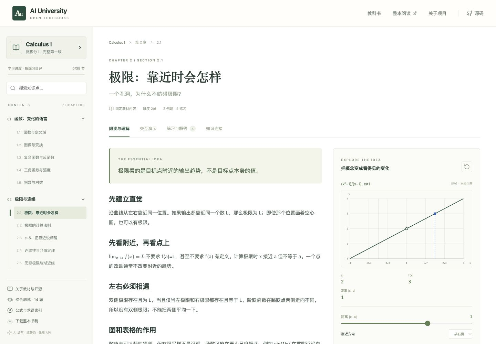
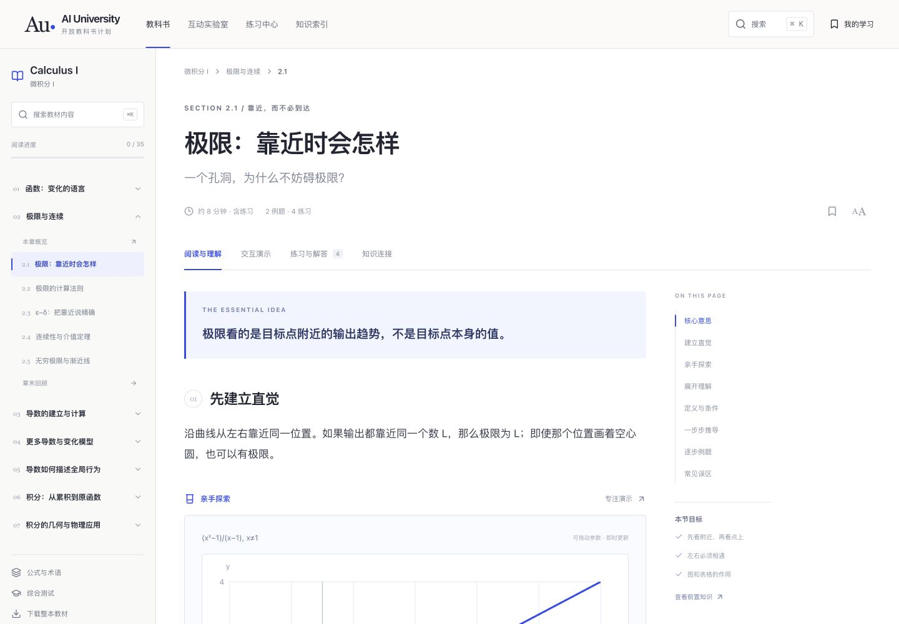
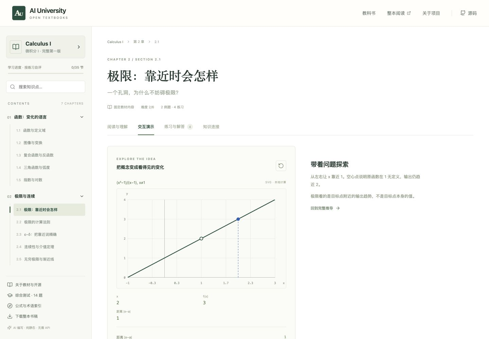
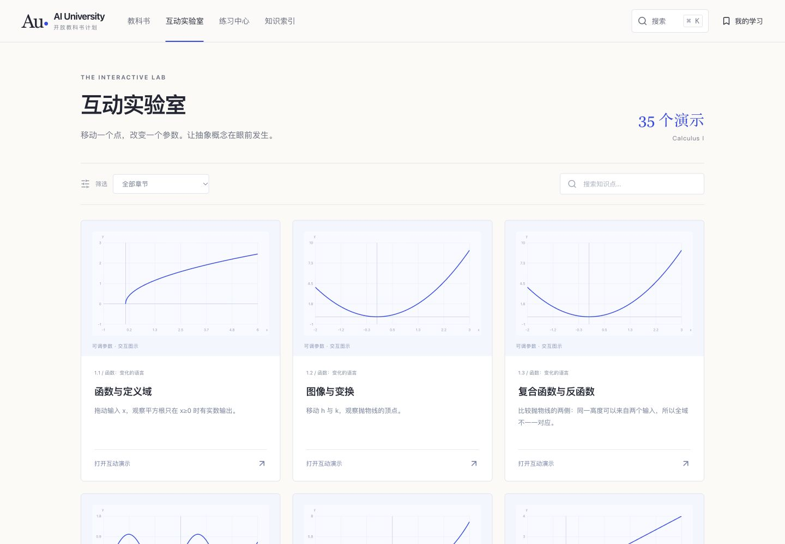
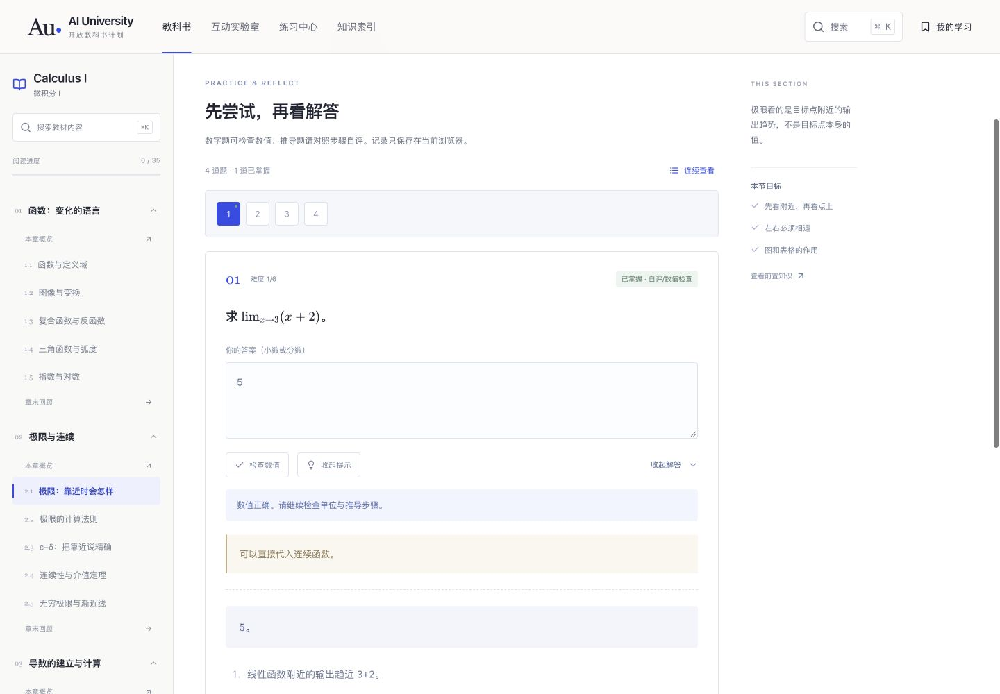
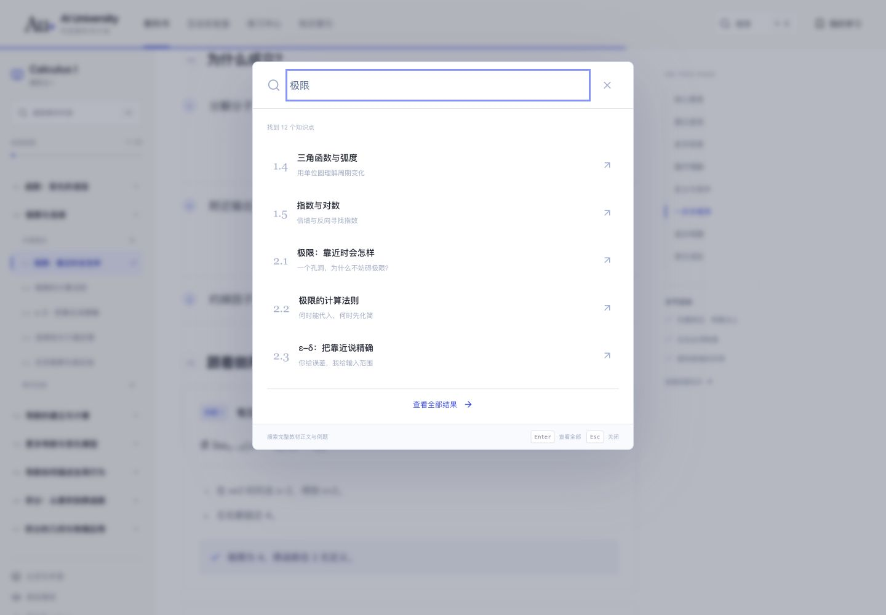

# v0.2.0 网站改版与体验审查

2026-10-10。本轮检查直接打开现有网站并捕获当前页面；下列截图均来自本轮，没有使用旧缓存作为审查证据。目标为完整的静态教科书网站，而非在线聊天服务。

## 1. 网站首页 — 原入口范围不足，已重建

原首页实际是单本教材目录：所有页面都带教材侧栏，读者无法区分网站、教材与章节层级。视觉统一，但元信息和操作文字偏小。

新版首页独立于阅读器，提供书库、教材、实验室、练习、索引与阅读指南的入口；主图是可操作的导数演示。顶部与页脚可直接到达网站支持页面。

## 2. 章节与阅读 — 阅读路径更清楚，正文已重排

原正文采用较窄的文字/图示并列布局，小号目录与较淡的标签增加了查找负担，手机阅读路径还需要单独处理。

新版区分教材主页、七个章节主页和三十五个小节页面。正文按核心意思、直觉、探索、解释、条件、推导、例题与误区组织；演示在正文中嵌入。桌面页内目录可定位段落，手机正文保持单列。

## 3. 演示 — 从单节附属入口变成可检索实验室

原演示可用，但只能从知识点进入；在演示页，图示与说明的空间分配不够均衡。

新版提供实验室：每页六个真实数学模型预览，按章节与关键词筛选，地址保存筛选与分页状态。每节仍有专注演示页与读数、滑块和动画。

## 4. 练习与搜索 — 主要流程已验证

练习提供逐题导航和连续查看，切换题目保留当前会话中的草稿。提示、完整解答、数值检查与自评分别呈现。搜索覆盖正文、定义、例题和练习，完整结果每页八项。

## 5. 响应式与可访问性 — 常用交互通过，非完整合规认证

- 1440px：逐节检查 35 节的正文结构、公式、例题、演示和练习。
- 每种演示中的滑块分别到最小与最大值，未出现 NaN/Infinity 图元。
- 390px：检查 60 个网站/章节/知识点页面，无页面横向溢出。
- 768px：检查 10 个代表页面，无页面横向溢出。
- 验证全文搜索输入、结果、分页；章节/关键词筛选保持输入焦点。
- 验证手机教材目录与全站导航；Escape 关闭教材目录并恢复触发按钮焦点。
- 验证数值题、提示、解答、逐题切换、重新加载后的记录；验证收藏与已读状态。
- 验证学习记录导出、三个练习状态批量导入及重新加载后的保留。

截图只支持视觉判断。上述交互另外通过浏览器操作检查；没有声称完整 WCAG 合规，也没有声称有限数学采样证明全部教材正确。Playwright 回归用例已更新，但本轮通过应用内浏览器完成验证，没有运行独立 Playwright 浏览器进程。

JSON 检查记录在 `docs/images/redesign/`。内容校验、类型检查、整本生成、构建与 11 项内容/数学测试通过。
