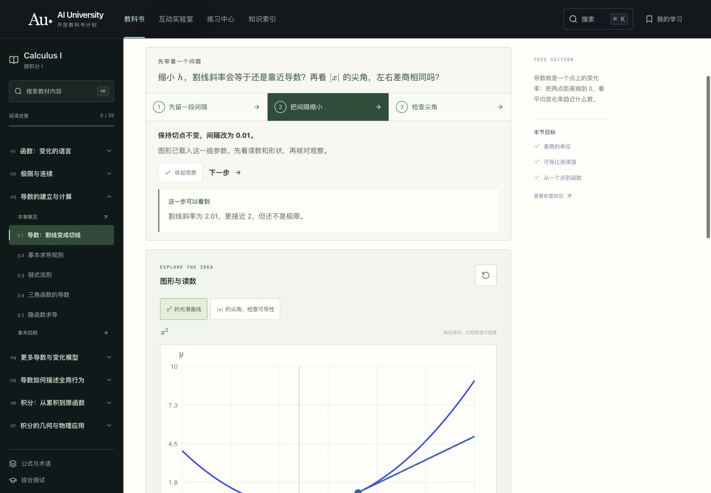
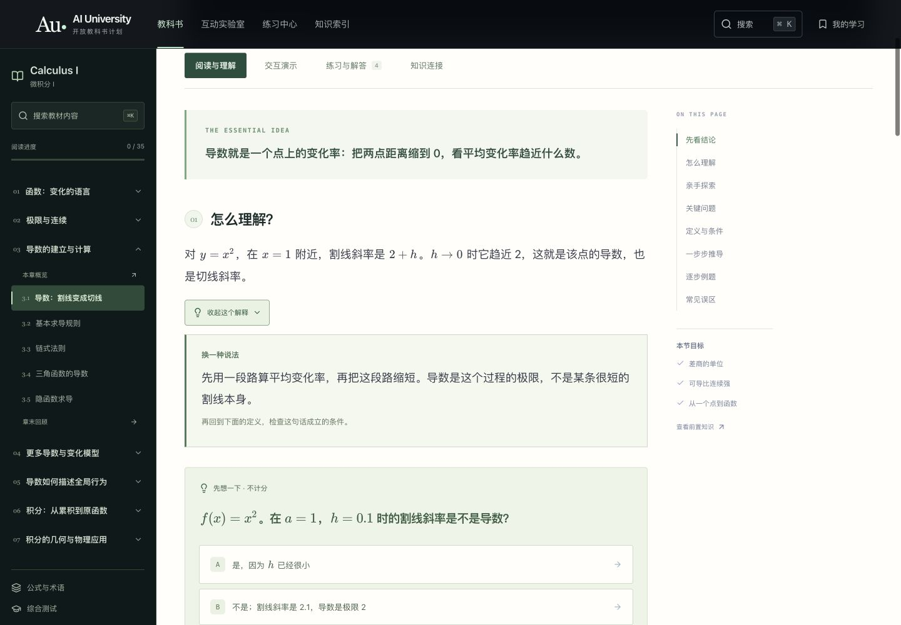
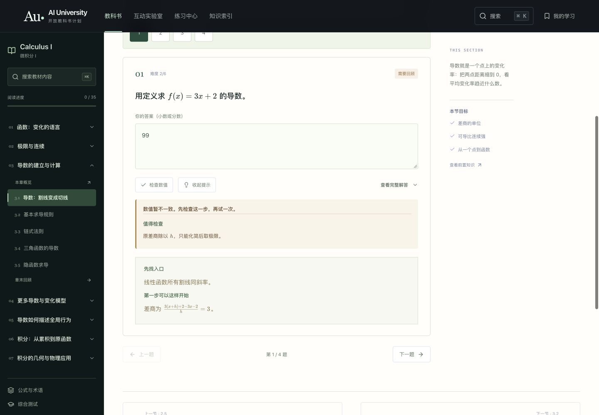
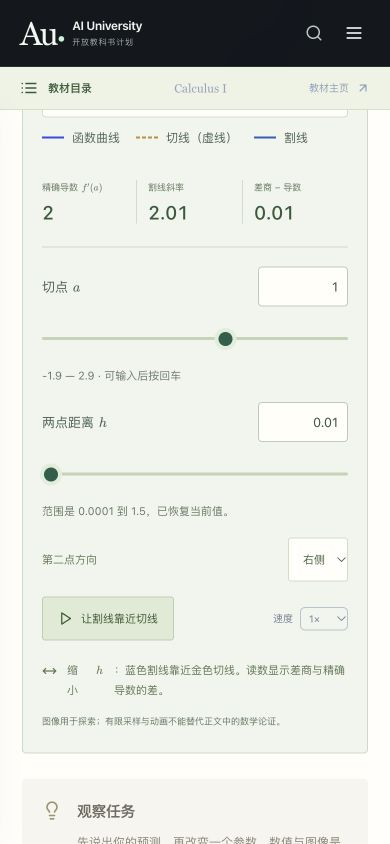

# 回答式教学与交互复核 · v0.7.0

日期：2026-10-12。教材版本：v0.3.1。复核目标：把固定教材中的解释、操作、观察与反馈连成一条清楚的学习路径。全书仍为 AI 离线编写，网页没有实时模型、聊天服务或账户。

本轮采用 Product Design 的体验审查流程，先在现有公开网站截图并走完代表学习路径，再在原有设计上修改。没有重建品牌或替换教材。以下证据均来自本轮实际页面。

## 按学习步骤检查

1. **读懂一个问题——可用。** 保留简明核心回答、直觉、条件和推导；35 节各写一段“换个角度理解”。读者主动展开，避免所有解释一起堆在正文里。解释、公式、例题均来自固定版本。
2. **带着问题操作图形——已加强。** 原先观察问题默认折叠，图前重复标题较多，缺少可直接执行的实验顺序。现在每节有三步实验，明确要改变什么量、看什么关系、在预设下会观察到什么。105 个按钮会实际载入参数，不是只换一段文字。
3. **自由调参数与恢复——可用。** 二维、三维和延伸模型共用参数输入。支持小数、简单分数与 `pi/2`、`3π/2` 等弧度写法；禁止执行任意表达式。范围错误、空值、整数参数的小数输入会恢复当前值并说明原因。输入保留完整数值精度，图中读数可显示舍入值。手动操作会暂停自动播放，并明确区分当前读数与原预设观察；可重新载入同一步。
4. **练习、提示与反馈——已加强。** 原先错误反馈只建议看提示，没有具体检查入口。现在对照题目提示与已有误区给出“值得检查”的地方，提示分为入口与第一步；完整解答仍可直接查看。数值匹配成功不会自动宣布掌握概念，读者确认能解释步骤后再标记理解；记录仍只在本地保存。
5. **手机与整本阅读——可用，检查有限。** 缩小演示/练习页的大标题，修正“三个问题”“两道例题”等固定文案。延伸模型按需展开，避免默认堆叠长页面。网页、搜索与打印书稿同步包含教学解释和实验文字。没有声称覆盖真实手机硬件或完整读屏测试。

## 截图与发现

### 演示入口

旧页面在图前重复展示标题，观察任务被折叠；只靠读者自己理解滑块用途。

改后可以载入一步、核对观察、进入下一步，也可以手动探索。图例不只依靠颜色说明切线与函数曲线。

### 解释方式

另一个角度直接回应当前概念，而不是新增聊天入口。仍提醒读者回到定义与适用条件。

### 练习反馈

旧反馈缺少具体入口。

新反馈指出可检查的条件，并提供逐层提示；颜色和文字共同区分反馈状态，不声称已自动诊断读者的认知缺口。

### 手机操作

旧演示页在首屏主要显示标题。新控件能直接输入、检查范围和恢复；触摸滑块与键盘操作都保留。

## 数学图示补充

- 连续性加入实际补点与点值调整。点值为 2 时与左右极限一致；改为 1 时明确显示仍不连续。
- 基本定理同时画被积函数、累积曲线和累积曲线的切线，使“高度等于累积速度”有可比较的表示。
- 修正原函数演示的曲线颜色说明，补齐切线/割线和正负积分贡献图例。
- 空心点、无定义输出、显示窗口截断、零导数、不可导尖角和牛顿法停止提示继续保留，不用动画代替条件与证明。

## 验证与边界

- `npm run check`：37 项测试、内容结构与数学排版、先修图、类型、整本生成和生产构建通过。
- [210 次实验状态检查](images/teaching-experience/experiments.json)：35 节 × 3 步 × 1440/390 两种宽度。每一组都核对参数是否载入，未发现公式错误、无效 SVG 数值或整页横向溢出。三维圆盘/圆环与二维/三维切换也核对了实际选择状态。
- [140 次阅读与练习检查](images/teaching-experience/reading-practice.json)：全书另一种解释可展开，题目数量与页面内容可用；两种宽度无公式错误或页面溢出。
- 手动检查精确输入、非法范围恢复、整数保护、预设重新载入、分层提示、正确答案后的主动确认及刷新后记录保留。输入 `pi/2` 后再次聚焦/离开，仍保留完整精度。
- 程序独立核对差商、不可导反例、误差保证、矩形和、牛顿步骤及圆盘/圆环面积。实验状态不能越过控件范围或对应定义域。
- 整本 HTML 实际含 35 节、35 组三步实验、79 例题与 191 练习，无公式渲染错误。可复用 Playwright 测试已同步；本轮实际浏览器检查通过应用内浏览器执行。

这些检查验证的是实现与所列数学条件，不证明整本教材绝无错误，也没有证明学习效果优于其他教学方法。没有进行完整 WCAG 审核、真实手机硬件兼容性或读屏器用户测试。预先写好的另一种解释与观察提示不冒充实时 AI 回答。
