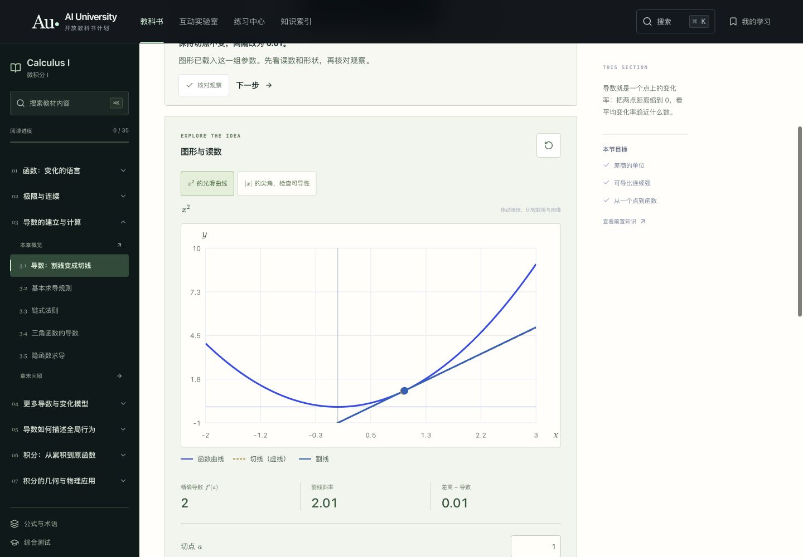
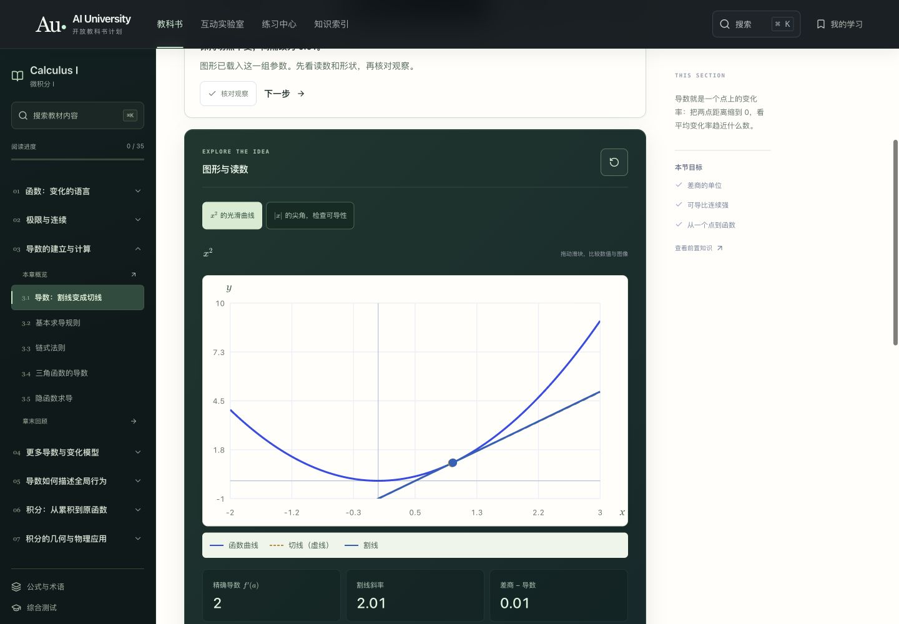
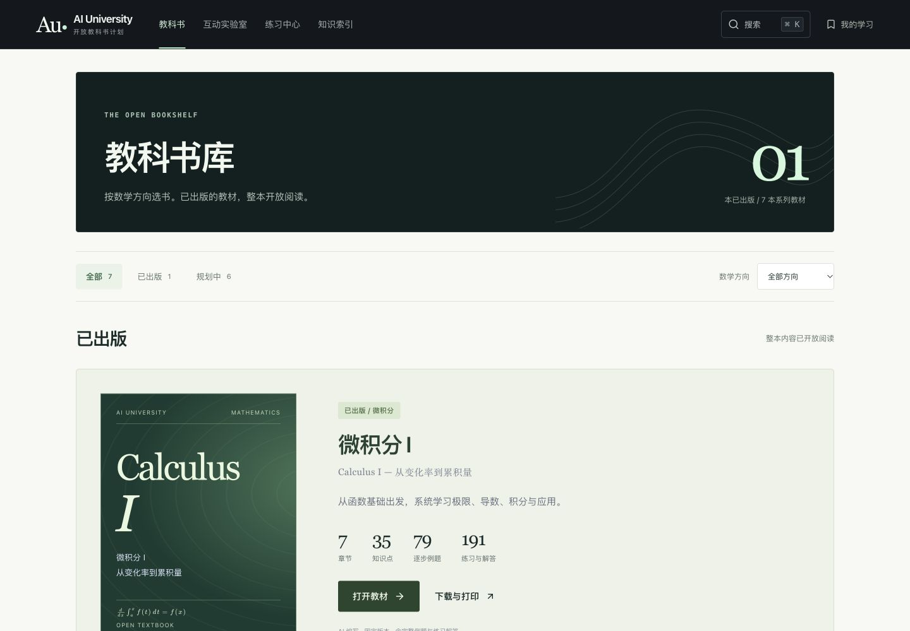
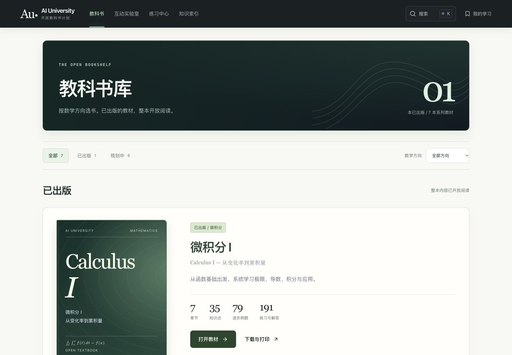
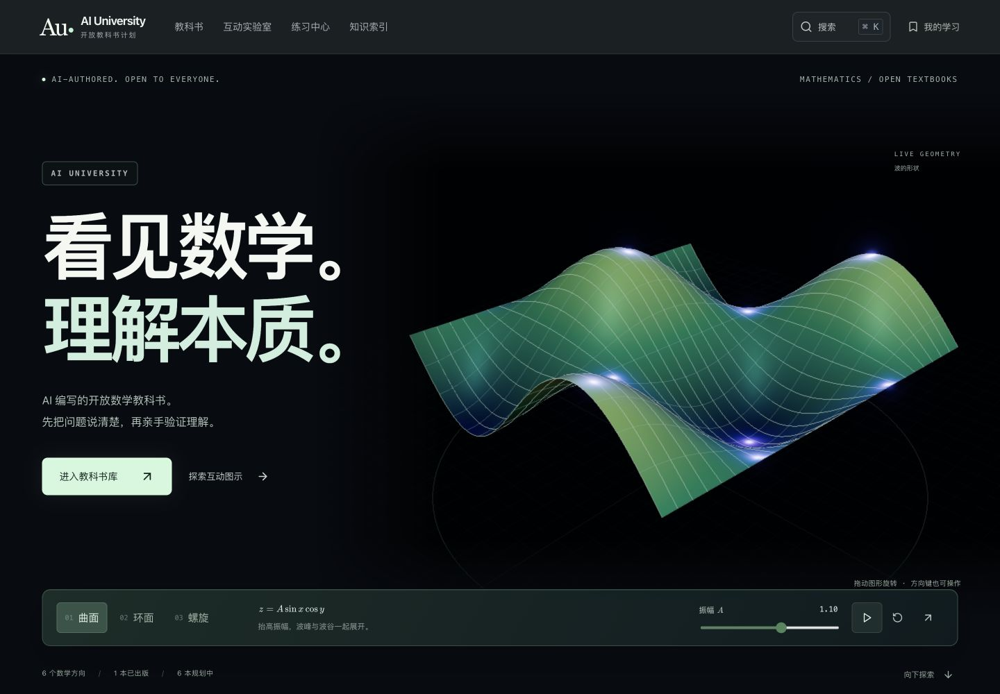
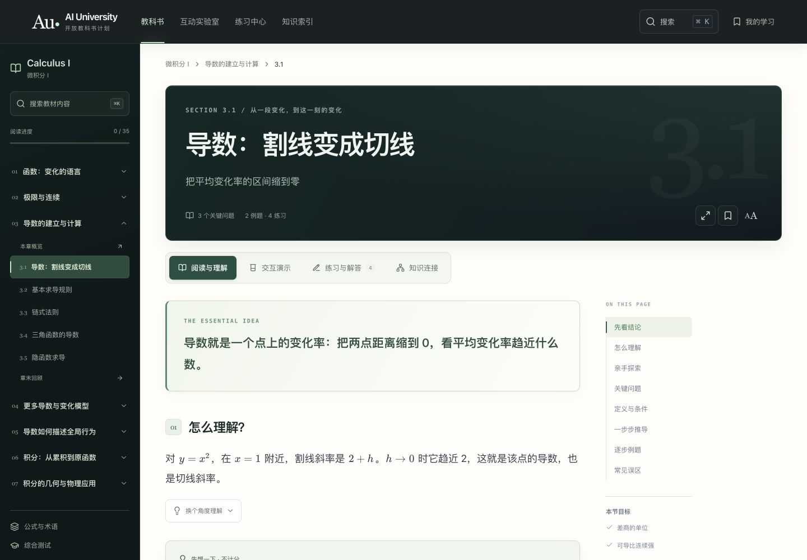
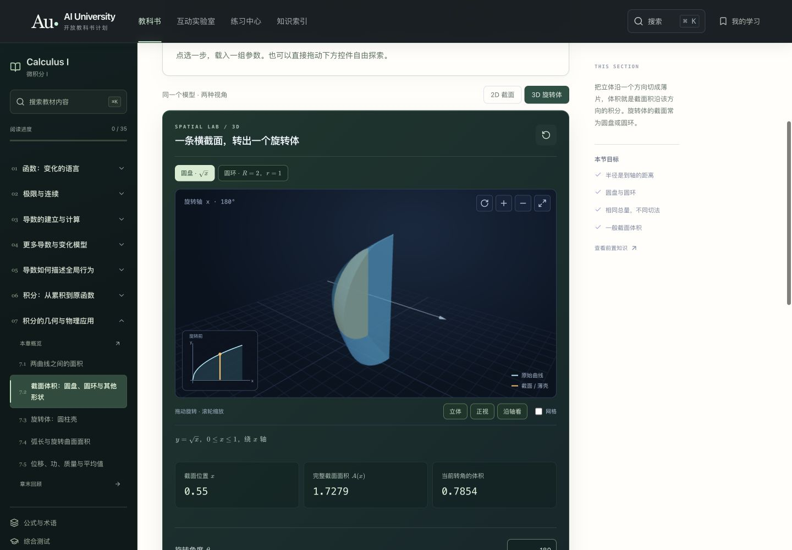
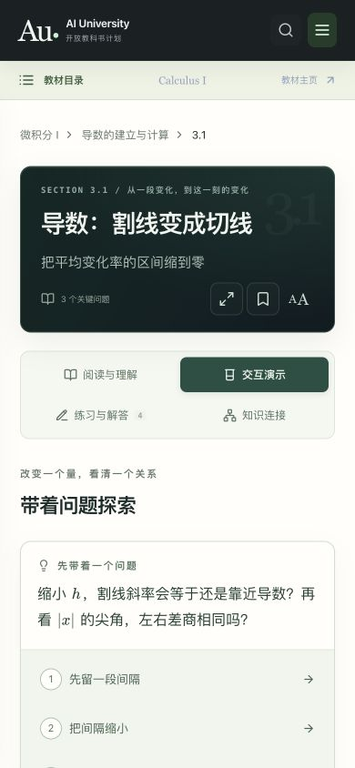
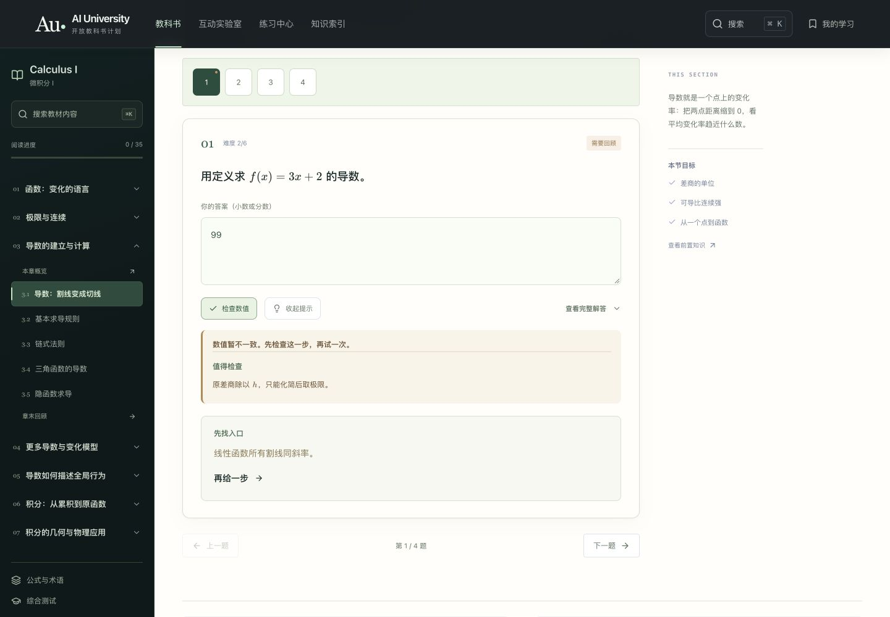

# 界面精修 · v0.8.0

日期：2026-10-14。沿用 AI University 的深色数学展厅与浅色阅读页，改善原本过于平、多个区域同色的问题。网站仍为纯静态；教材保持 v0.3.1，内容、例题、题目与数学模型未改动。

## 实际变化

- 首页：保留可旋转的数学曲面，形态选择、公式、参数与播放按钮组成完整控制台；选中和悬停状态更明确。
- 教材库与资源页：统一渐变标题面板、圆角、边框和阴影；已出版教材使用白色卡片和更清楚的封面层次，规划中条目保持较轻的呈现。
- 阅读：四个内容入口增加图标；核心解释、段落编号、另一个角度的解释、例题和提示统一表面与间距。
- 实验：二维和三维采用统一的深色外框；二维坐标图保留浅色纸面，图例有独立底色，读数分成清楚的数值卡片。参数输入、模型选择、维度切换与播放状态使用一致的按钮样式。
- 手机：四个内容入口采用两行排列，避免最后一个入口被藏在横向滚动中；放大坐标刻度字号，保留滑块与精确输入。减少动态效果偏好规则继续生效，没有新增正文背景动画。

## 同状态前后对比

导数实验都选择第 2 步，切点 1、距离 0.01；1440 × 1000 视口，实验台顶端约在 208 px。数学图形与数值保持一致，变化在分层和操作区的视觉形式。

| 调整前 | 调整后 |
| --- | --- |
|  |  |

| 教材库调整前 | 教材库调整后 |
| --- | --- |
|  |  |

## 验证

- `npm run check`：生产构建、内容校验、类型与 37 项测试通过。
- [224 个布局状态](images/visual-refinement/layouts.json)：1440 与 390 宽度分别检查全部 35 节阅读页、35 节实验页和 26 个主要页面/筛选状态；320 与 820 宽度各检查 16 个代表页面。未发现整页横向溢出、KaTeX 渲染错误或非有限 SVG 路径数值。
- 实际截图复核：首页、教材库、阅读、二维与三维实验、练习反馈和手机四入口。
- 手动操作：分数 `1/10` 将距离设为 0.1，差商显示 2.1；输入 0 时恢复有效值并提示范围；重新载入第 2 步恢复 0.01。三维放大与恢复视角可用，角度输入 180 后读数显示 180°。
- 错误答案、正确答案及分层提示可用；手机搜索可找到极限章节，网站导航可打开与关闭。
- 新增动效限于控件的短暂悬停/按下反馈；保留原有数学动画和手动暂停。减少动态效果的新增样式通过源码检查，没有改变操作系统设置模拟该偏好。

检查覆盖上述浏览器状态与实际截图，未进行完整 WCAG 审核、读屏器用户测试或所有真实设备的兼容性测试。
